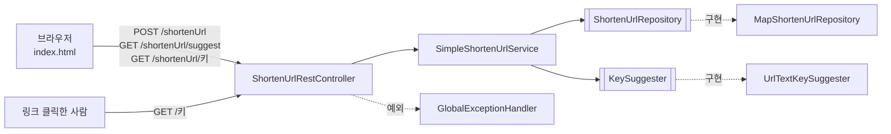

# custom-link

> 나만의 주소로 링크를 공유하고, 몇 명이 들어왔는지 확인하는 URL 단축 서비스

<br>

## 1. 앱 소개

긴 URL을 짧은 주소로 바꿔 주는 서비스입니다. 랜덤 문자열 대신 **원하는 단어로 주소를 정할 수 있고**, 무엇으로 정할지 고민될 때는 **원본 URL을 분석해서 키를 추천**해 줍니다. 만든 링크가 **몇 번 클릭됐는지**도 확인할 수 있습니다.
교재를 참고해 단축url 생성 기본 기능들을 구현하였고, 추가적으로 원하는 대로 url을 커스텀하거나 추천받을 수 있도록 만들었습니다.

```
https://docs.google.com/forms/d/e/1FAIpQLSf.../viewform
                        ↓
              http://{도메인}/2026-recruit      (클릭 수: 37회)
```


### 누구를 위한 서비스인가요?

**동아리, 학생회, 소규모 행사 운영자**

모집 공고나 신청 링크(주로 구글폼)를 포스터, 인스타그램, 카카오톡 단톡방, 커뮤니티 게시판 등 여러 곳에 동시에 공유하고, 방문 클릭 횟수를 알고 싶은 담당자들을 위한 서비스 입니다.

### 어떤 불편함을 해결하나요?

| 불편함 | 해결 방법 |
|---|---|
| 구글폼 링크가 너무 길고 복잡해서 포스터에 넣거나 손으로 입력할 수 없다 | **원하는 키로 단축 URL 생성** (`/2026-recruit`) |
| 키를 뭐라고 지을지 고민된다 | **URL을 분석한 키 추천** (클릭 한 번으로 선택) |
| 링크를 뿌린 뒤 실제로 몇 명이 들어왔는지 모른다 | **링크별 클릭 수 집계** |
| 채널마다 효과를 비교하고 싶다 | 채널별로 다른 키(`/recruit-insta`, `/recruit-poster`)를 만들어 **클릭 수를 비교** |
| 내가 만든 링크를 다시 찾기 번거롭다 | **로그인 없이 "내가 만든 링크" 목록** 제공 |

<br>

## 2. 구성도

### 패키지 구조

계층별로 패키지를 나누고, 저장 방식과 추천 방식은 **인터페이스(domain)와 구현체(infrastructure)로 분리**했습니다.

```
kr.co.shortenurlservice
├── presentation      요청/응답 처리 (Controller, DTO, 예외 → HTTP 응답 변환)
├── application       비즈니스 흐름 (SimpleShortenUrlService)
├── domain            핵심 모델과 규칙, 인터페이스
│   ├── ShortenUrl              단축 URL 모델 + 키 규칙(형식, 예약어, 랜덤 생성)
│   ├── ShortenUrlRepository    저장소 인터페이스
│   ├── KeySuggester            키 추천 인터페이스
│   └── *Exception              도메인 예외 (중복, 예약어, 없음, 키 부족)
└── infrastructure    인터페이스의 실제 구현
    ├── MapShortenUrlRepository  메모리(ConcurrentHashMap) 저장소
    └── UrlTextKeySuggester      URL 글자 분석 기반 키 추천

resources/static/index.html      프런트엔드 (순수 HTML·CSS·JavaScript)
```

### 요청 흐름



서비스는 인터페이스(`ShortenUrlRepository`, `KeySuggester`)에만 의존합니다. 그래서 저장소를 DB로 바꾸거나 추천 방식을 페이지 제목·AI 기반으로 바꿀 때, **구현체만 추가하면 되고 서비스·컨트롤러는 수정하지 않아도 됩니다.**

### 도메인 모델

```
ShortenUrl
├── shortenUrlKey   단축 키 (랜덤 8자 또는 사용자가 정한 4~20자)
├── originalUrl     원본 URL
└── redirectCount   클릭(리다이렉트) 수
```

### API

| 메서드 | 경로 | 설명 | 주요 응답 |
|---|---|---|---|
| `POST` | `/shortenUrl` | 단축 URL 생성 (`customKey` 선택) | 200, 400(형식·예약어), 409(중복) |
| `GET` | `/shortenUrl/suggest?url=` | 키 추천 (최대 3개) | 200 |
| `GET` | `/shortenUrl/{키}` | 단축 URL 정보와 클릭 수 조회 | 200, 404 |
| `GET` | `/{키}` | 원본 URL로 이동 + 클릭 수 증가 | 302, 404 |

<br>

## 3. 기술적으로 고민한 부분

### 3-1. 리다이렉트 상태 코드: 301 → 302

처음에는 `301 Moved Permanently`로 리다이렉트했습니다. 그런데 301은 "영구 이동"이라는 뜻이라 **브라우저가 결과를 캐시**합니다. 같은 브라우저에서 같은 링크를 다시 열면 서버에 요청이 오지 않고 브라우저가 바로 이동해 버리기 때문에, **클릭 수가 실제보다 적게 집계**됩니다.

클릭 수 집계가 이 서비스의 핵심 기능이므로 `302 Found`로 바꿨습니다. 302는 캐시되지 않아서 매 클릭이 서버를 거칩니다.

| | 301 | 302 |
|---|---|---|
| 브라우저 캐시 | O | X |
| 서버 부하 | 적음 | 클릭마다 요청 |
| 클릭 수 정확도 | 낮음 | **높음** |

### 3-2. 키 추천 기준

외부 사이트에 접속하지 않고 **URL 문자열만 분석**합니다. 빠르고, 서버가 사용자가 입력한 주소에 직접 접속하지 않으므로 SSRF(서버 측 요청 위조) 위험이 없습니다.

**① 후보 만들기** (`UrlTextKeySuggester`)

1. **도메인에서 사이트 이름 추출**: 최상위 도메인(`.com`, `.kr`)과 2단계 접미사(`co.kr`의 `co`)를 제거합니다.
   `www.coupang.co.kr` → `coupang`
2. **의미 있는 서브도메인 추출**: `www`, `m` 같은 서브도메인은 무시합니다.
   `docs.google.com` → `google-docs`
3. **경로의 마지막 의미 있는 단어 추출**: 다음은 제외합니다.
   - 의미 없는 단어: `watch`, `view`, `viewform`, `post` 등
   - 5자리 이상 숫자 (글 번호): `223456789`
   - 문자와 숫자가 섞인 6자 이상 문자열 (랜덤 ID): `1FAIpQLSf`
4. **조합 및 정리**: `경로단어` → `사이트-경로단어` → `사이트-서브도메인` → `사이트` 순서로 우선순위를 둡니다. 소문자로 바꾸고, 영문·숫자 외 문자는 하이픈으로 바꿉니다. 20자를 넘으면 하이픈 경계에서 자르고, 4자 미만이면 `-link`를 붙입니다.

| 원본 URL | 추천 키 |
|---|---|
| `github.com/spring-projects/spring-boot` | `spring-boot`, `github-spring-boot`, `github` |
| `docs.google.com/forms/d/e/1FAIp.../viewform` | `google-docs`, `google` |
| `blog.naver.com/someuser/223456789` | `someuser`, `naver-someuser`, `naver-blog` |
| `x.com` | `x-link` |

**② 실제로 쓸 수 있는 키만 남기기** (`SimpleShortenUrlService`)

- 예약어(`suggest`, `shortenurl`, `admin` 등)는 제외합니다.
- 이미 사용 중인 키는 `-2`, `-3`, ... `-9`를 붙여서 비어 있는 키를 찾습니다.
  `spring-boot`가 이미 있으면 → `spring-boot-2`
- 최대 3개까지 추천합니다.

**③ 확장성**

추천 로직을 `KeySuggester` 인터페이스로 분리했습니다. URL에 의미 있는 단어가 없는 경우(예: `forms.gle/AbX9k2`)에 대응하기 위해, 앞으로 **페이지 제목 기반**이나 **AI 기반** 추천 구현체를 추가할 예정입니다.

### 3-3. 로그인 없이 "내가 만든 링크" 확인하기

회원가입 없이 바로 쓸 수 있어야 진입 장벽이 낮다고 판단했습니다. 그래서 내가 만든 링크 목록을 **서버가 아니라 브라우저의 `localStorage`에 저장**합니다.

- 링크를 만들면 `{ 키, 원본 URL }`을 `localStorage`에 최대 20개까지 저장합니다.
- 서버는 사용자 정보를 전혀 저장하지 않습니다. 목록은 **그 브라우저에서만** 보이고, 다른 사람이 볼 수 없습니다.
- 목록에서 "조회수" 버튼을 누르면 서버에서 최신 클릭 수를 가져옵니다.
- 시크릿 모드처럼 `localStorage`가 막힌 환경에서도 화면이 깨지지 않도록 모든 접근을 `try/catch`로 감쌌습니다.

**한계**: 브라우저 데이터를 지우면 목록이 사라지고, 다른 기기에서는 볼 수 없습니다. 또 클릭 수 조회 API는 키만 알면 누구나 호출할 수 있습니다. 이후 링크 생성 시 관리 토큰을 발급하거나 로그인을 도입해 **만든 사람만 통계를 볼 수 있도록** 개선할 계획입니다.

### 3-4. 동시 요청에서 키 중복 막기

기존에는 "키가 있는지 조회(`find`) → 없으면 저장(`save`)"의 두 단계로 처리했습니다. 이 방식은 두 요청이 동시에 같은 키를 원하면 **둘 다 "없다"고 판단하고 나중 요청이 먼저 저장된 링크를 덮어쓰는** 문제(check-then-act 경쟁 상태)가 있습니다. 사용자가 키를 직접 정할 수 있게 되면서 같은 키를 동시에 요청할 가능성이 실제로 생겼습니다.

`ConcurrentHashMap.putIfAbsent()`로 **확인과 저장을 하나의 원자적 연산**으로 바꿔, 동시에 요청해도 한 명만 성공하고 나머지는 `409 Conflict`를 받도록 했습니다. 랜덤 키와 직접 정한 키가 같은 공간을 쓰므로, 랜덤 키 생성에도 같은 방식을 적용했습니다.

### 3-5. 사용자 지정 키 검증

- **형식 검증**: 영문, 숫자, 하이픈으로 4~20자 (`@Pattern`). 규칙은 `ShortenUrl.CUSTOM_KEY_REGEX` 한 곳에서 관리하고, 요청 검증과 추천 기능이 같은 규칙을 씁니다.
- **예약어 차단**: `shortenurl`, `suggest`처럼 API 경로와 겹치는 단어를 막습니다. 예를 들어 누군가 `suggest`라는 키를 만들면 `GET /shortenUrl/suggest`가 키 추천 API로 처리되어 그 링크의 정보를 조회할 수 없게 되기 때문입니다.
- **에러 메시지**: 검증에 실패하면 어떤 필드가 왜 틀렸는지 응답에 담아 보냅니다.
  `400 customKey: customKey는 영문, 숫자, 하이픈(-)으로 4~20자여야 합니다.`

### 3-6. 리다이렉트 경로와 정적 파일의 충돌

프런트엔드(`index.html`)를 Spring의 `static` 폴더에 두자 첫 화면이 열리지 않았습니다. `/` 요청이 내부적으로 `/index.html`로 전달되는데, 이것을 리다이렉트용 `GET /{shortenUrlKey}`가 키로 받아 버렸기 때문입니다.

경로 변수를 `/{shortenUrlKey:[a-zA-Z0-9-]+}`로 제한해서, 점(`.`)이 들어간 정적 파일 요청은 컨트롤러로 오지 않도록 했습니다.

<br>

## 실행 방법

```bash
./gradlew bootRun
```

브라우저에서 `http://localhost:8080` 접속

- Java 21, Spring Boot 4.1
- 현재는 메모리에 저장하므로 서버를 재시작하면 데이터가 초기화됩니다.
